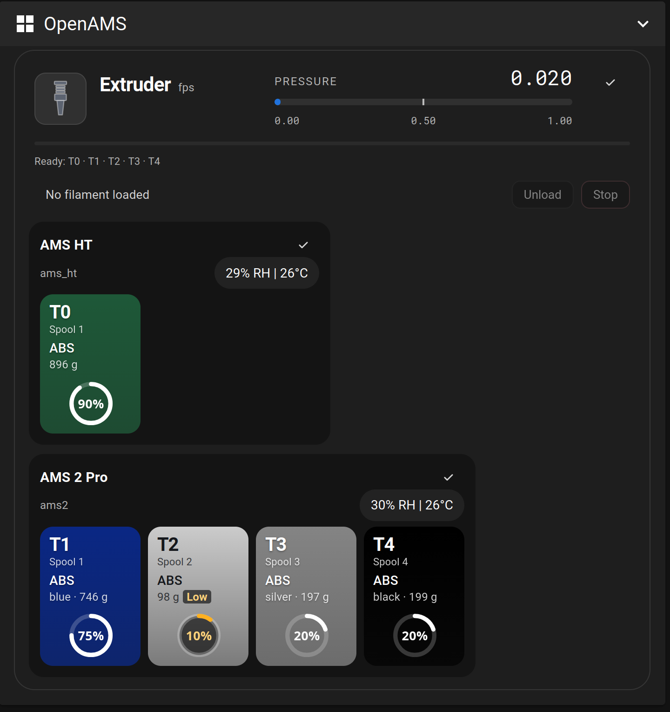

# OpenAMS UI

The OpenAMS user interface: a small touchscreen dedicated to a printer's
multi-material unit, plus the same views as a panel in Mainsail and Fluidd.
The ready-made Mainsail with the panel is
[OpenAMSOrg/mainsail](https://github.com/OpenAMSOrg/mainsail); OpenAMS's
`install.sh --mainsail-panel` installs it. One C core
(`src/model`, `src/backend`, `src/view`) feeds three renderers: the LVGL
screens on an ESP32 display, a desktop simulator and a Vue 2 web panel.



> [!IMPORTANT]
> **This needs the current OpenAMS on the printer: [OpenAMSOrg/openams](https://github.com/OpenAMSOrg/openams). It does not work with `klipper_openams`.**
> The display and the Mainsail panel read the `openams_ui <unit>` objects that only the current OpenAMS publishes. With `klipper_openams` the display connects but shows nothing about your units ("The printer shows no OpenAMS unit"), and the panel stays empty.
> Moving over is one installer run, keeps your `oams.cfg`, and every G-code command keeps working: [Moving from klipper_openams](https://github.com/OpenAMSOrg/openams/blob/main/docs/guide/install.md#moving-from-klipper_openams).

Target hardware is LCDWiki's 4.0 inch ESP32-32E display (E32R40T:
ESP32-WROOM-32E, 520 KB SRAM, no PSRAM, 4 MB flash): a 480x320 ST7796S panel
over SPI with an XPT2046 resistive touch controller. Pins and
panel options are in [the hardware page](docs/guide/hardware.md).

**Start with the [user guide](docs/guide/README.md).** It covers hardware,
flashing, first setup, daily use, the web panel, troubleshooting and
development. `docs/SPEC.md` is the full spec (screens, data model, look). The
rest of this file is developer reference for the simulator and the builds.

## Build

```sh
cmake -S . -B build -DCMAKE_BUILD_TYPE=Release
cmake --build build -j4
```

The build depends on `lib/lvgl` (a git submodule) and SDL2 (`pkg-config
sdl2` must resolve — `apt install libsdl2-dev` / `brew install sdl2`). First
checkout:

```sh
git submodule update --init --recursive
```

## Language builds

A device needs only its user's language, so a build takes the set it carries:
every string table and every CJK font face of that set, and nothing else (the
eleven languages together cost about 240 KB of fonts, most of an image that has
to fit two OTA slots). `MMU_LANGUAGES` is the one list, read by
`cmake/languages.cmake` in every build:

| `MMU_LANGUAGES` | Languages |
|-----------------|-----------|
| `all` | every language, the pseudo-locale included: the default for the simulator, the browser build, the wasm core and the tests |
| `latin` | `en de es fr it pl pt-BR ru` — the **ESP32 default** |
| `ja`, `ko`, `zh-Hans` | that language plus `en` |
| `en;ja` | any `;`-separated list of codes; `en` is always added, since it is the fallback |

An unknown code is a configure error that names it. A build that does not carry
a language offers it nowhere: the settings list shows only the compiled
languages, a stored (NVS) language that is not compiled in falls back to English
without an error, and `./build/openams-ui-sim --lang de` on a `ja` image says
so and uses English.

```sh
cd platform/esp32
idf.py -DMMU_LANGUAGES=ja build          # -> build/openams-ui_1.0.0-ja.bin
idf.py -DMMU_LANGUAGES=zh-Hans flash monitor
```

The app version carries the set (`1.0.0-latin`, `1.0.0-ja`, ...), so an image
can be told apart from another in the OTA console and by
`esp_ota_get_partition_description()`. The base version is `MMU_APP_VERSION`
(default `1.0.0`): `idf.py -DMMU_APP_VERSION=1.1.0 -DMMU_LANGUAGES=ko build`.

The simulator takes the same flag, in its own build directory:

```sh
cmake -S . -B build-ja -DCMAKE_BUILD_TYPE=Release -DMMU_LANGUAGES="en;ja"
cmake --build build-ja -j4 && ctest --test-dir build-ja
```

## Spool tag writer

The ESP32 image carries a spool tag writer by default (**Menu → Tag writer**):
it composes a spool and writes it to an RFID tag, reads any filament tag, and
resets, copies and clones Bambu tags, with a PN5180 (or `-DMMU_TAG_READER=MFRC522`)
on the board's VSPI connector. `-DMMU_SPOOL_TAG_WRITER=OFF` builds the display
alone. An image with the tag writer trades the two OTA slots for an on-device
tag library (`platform/esp32/partitions_tagwriter.csv`) and is updated over USB.
The tag writer (`platform/esp32/tag_writer/`) is under the GPLv3, so an image
built with it is too; the display alone stays MIT. See
[docs/guide/tag-writer.md](docs/guide/tag-writer.md).

## Run

```sh
./build/openams-ui-sim                       # interactive: 480x320 window, zoomed 4x by default (`--zoom N`)
./build/openams-ui-sim --scenario drying      # start on a specific scenario
```

Flags:

| Flag | Effect |
|------|--------|
| `--scenario NAME` | Initial scenario for interactive runs (`idle`, `loading`, `error`, `drying`, `printing`, `runout`, `dual`). Also reachable at runtime from the hidden debug screen (long-press the top bar title). |
| `--smoke` | Walks every scenario x every screen x every modal, exits 0 and prints `SMOKE OK scenarios=<n> screens=<n> modals=<n> peak=<max_used>/<total>`, or exits 1 if a screen fails to build or LVGL's heap peak exceeds 90% of `LV_MEM_SIZE`. |
| `--screenshots DIR` | Same walk, writing one 24-bit BMP per screen/modal into `DIR` (`<scenario>_<screen>.bmp`, `<scenario>_<screen>_modal<i>.bmp`). |
| `--gallery DIR` | Renders the component gallery: one page per component family into `DIR/gallery_<name>.bmp`, audited as `gallery/<name>`. Prints `GALLERY OK issues=<n>` and exits 0 when clean, or `GALLERY FAIL issues=<n>` and exits 1. |

`--smoke`, `--screenshots` and `--gallery` drive LVGL's tick themselves (not
wall-clock time), so they run fast and give the same result on every machine:

```sh
SDL_VIDEODRIVER=dummy ./build/openams-ui-sim --smoke
SDL_VIDEODRIVER=dummy ./build/openams-ui-sim --screenshots out/
SDL_VIDEODRIVER=dummy ./build/openams-ui-sim --gallery build/gallery
```

`SDL_VIDEODRIVER=dummy` is only needed where no display is available (CI, a
headless dev box); a real desktop can drop it and watch the window while the
walk runs.

## Browser build

The same UI, compiled to WebAssembly with Emscripten and running against the
same LVGL SDL driver (Emscripten supplies SDL2 via `-sUSE_SDL=2`). Live at
<https://openamsorg.github.io/mmu-display-demo/>.

```sh
source <path-to-emsdk>/emsdk_env.sh   # emsdk install latest && emsdk activate latest, once
scripts/build-web.sh                  # -> build-web/site/{index.html,openams-ui-web.js,openams-ui-web.wasm}
python3 -m http.server -d build-web/site 8000   # try it locally
```

`scripts/publish-web.sh` rebuilds and pushes a fresh `build-web/site/` to the
`OpenAMSOrg/mmu-display-demo` repo's `main` branch (site files only — never
this source tree), which GitHub Pages redeploys within a minute or two. One
command for every future update:

```sh
scripts/publish-web.sh
```

`platform/web/main.c` drives the loop with `emscripten_set_main_loop()`
instead of the simulator's blocking `for(;;)`, and exposes `web_set_scenario`
/ `web_set_unit` so the page's pickers can steer a running instance without a
reload; `platform/web/index.html` is the page itself. `?scenario=NAME` and
`?unit=NAME` in the URL pick the starting scenario/unit, same names as
`--scenario`/`--unit` above.

## Tree layout

```
lib/lvgl/                LVGL v9.6.0 (submodule, not modified)
lv_conf.h                ONE config shared by the simulator and the ESP32 build
src/model/               mmu_model.h/.c   — dummy data + scenarios (pure C, no LVGL)
src/ui/                  one .c/.h pair per screen, plus ui_theme, ui_nav, ui_widgets
src/app/                 app.h/.c (start-up, scenario switch), actions.h/.c (action log)
platform/sim/main.c      SDL window + mouse, CLI flags, the --smoke/--screenshots walk
platform/sim/gallery*.c  the component gallery: one page per family, rendered by --gallery
platform/web/            Emscripten/WebAssembly build: main.c + the demo page (see Browser build)
platform/esp32/          ESP-IDF firmware for the display (see docs/guide/flash-and-setup.md)
CMakeLists.txt           simulator build
```

## Portability rules

- **C99**, LVGL 9.6 API only. `src/` includes nothing but `lvgl.h`, the C
  standard headers `<stdint.h> <stdbool.h> <stddef.h> <string.h> <stdio.h>
  <stdarg.h>` and project headers — no SDL, no POSIX, no `malloc`/`free`
  (static storage only; LVGL objects are the only heap users). Platform
  specifics (display, input, time source, screenshot capture) live in
  `platform/`, which has no such restriction: `platform/sim/main.c` links
  SDL2 directly and uses plain C file I/O for the BMP encoder and static
  buffers for snapshot capture.
- **Memory budget = the CYD's.** `lv_conf.h` caps LVGL's own heap
  (`LV_MEM_SIZE`) at 64 KB — comfortably enough for objects, styles and
  strings, but far too small for a full 480x320 snapshot buffer (RGB888 alone
  is 461 KB). `--screenshots` therefore hands `lv_snapshot_take_to_draw_buf()`
  its own statically-allocated buffers instead of using `lv_snapshot_take()`,
  which would try to allocate through that 64 KB pool and fail. This is
  simulator-only tooling and never reaches the ESP32 build.
- **One screen alive at a time.** Navigating (`ui_nav_goto()`) builds the new
  screen and lets LVGL delete the previous one. Modals live on
  `lv_layer_top()` and are deleted on close.

## CI

Every push and pull request runs two GitHub Actions jobs defined in
`.github/workflows/ci.yml`:

| Job | What it checks |
|-----|----------------|
| **linux** | Builds the SDL simulator on ubuntu-latest; runs all CTest unit tests; runs `--smoke --audit` (fails unless `AUDIT TOTAL issues=0`); runs `e2e_mock_moonraker.sh`, `e2e_actions.sh`, and `replay_vams_fixtures.sh` against a fresh clone of `OpenAMSOrg/openams` (any `SKIP` output is treated as a failure). |
| **esp32** | Builds the ESP32 firmware with ESP-IDF v6.0.1 inside the `espressif/idf:v6.0.1` container, once per language set (`latin`, `ja`, `ko`, `zh-Hans`, see [Language builds](#language-builds)); checks that static DRAM free >= 20 000 bytes via `tools/ci/esp32_size_check.py` on each. |

Superseded runs on the same branch are canceled automatically via the
`concurrency` key.

## Translations

- German: wick69
- Russian: [Slick](https://github.com/SlickTorpedo)
