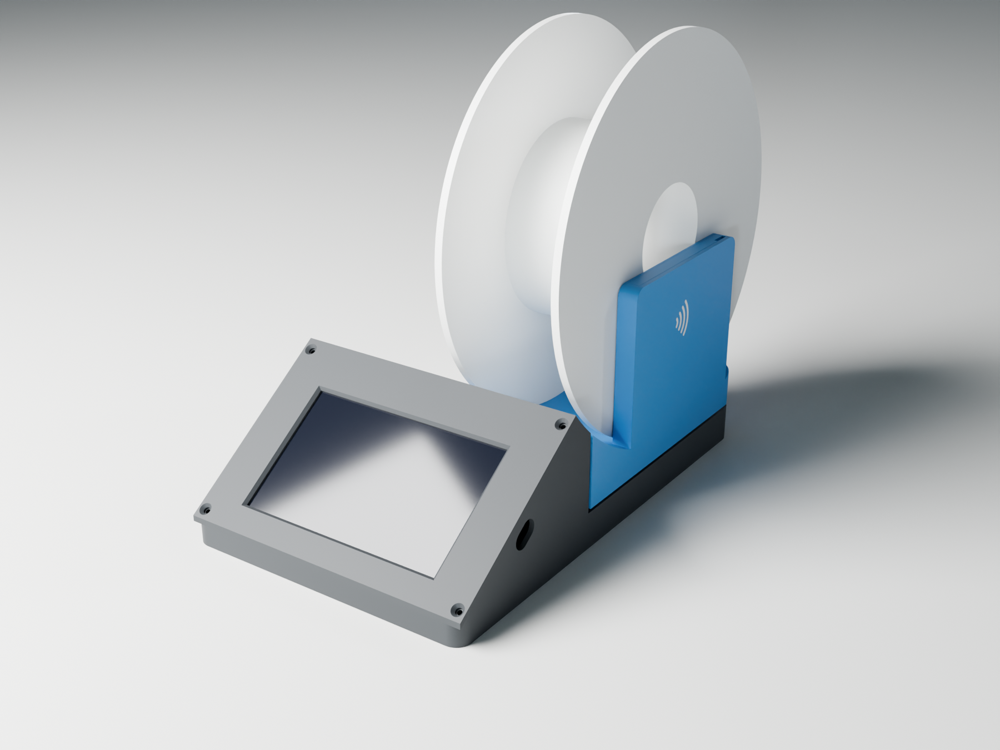
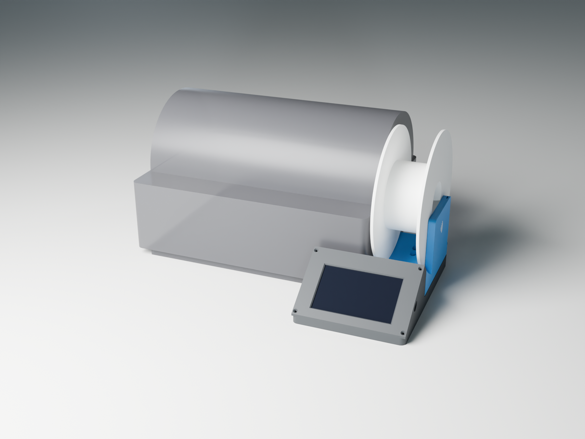
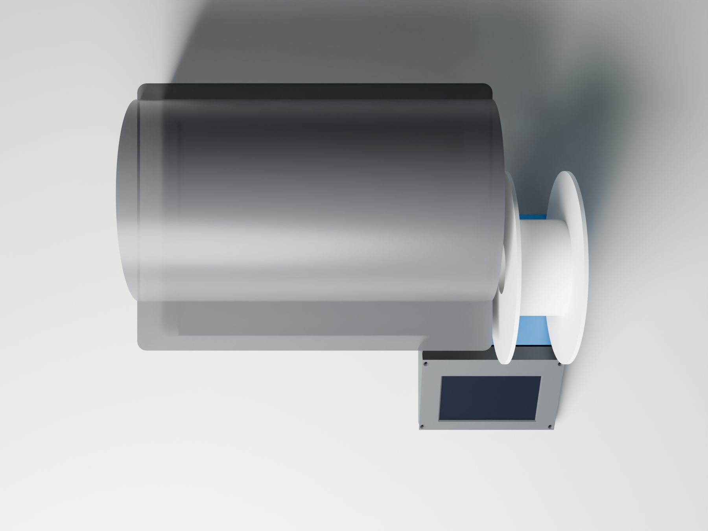

# Spool station

A stand for the 5" ES3C50P display, its PN5180 tag reader and a 5 kg load cell,
made to stand on the right of an AMS 2 Pro. A spool stands in the cradle to be
weighed. Its tag lies against the fin on the right, where the reader is, and the
screen runs openams-ui.



## Beside the AMS 2 Pro

The base is L-shaped. The screen pod spans the full width, and behind it only the
cradle remains, 75 mm wide from the fin. The AMS stands in the notch on the left,
with its front against the pod's back and its right side against the base. That
puts the screen's left 70 mm in front of the AMS's front-right corner. There is
0.8 mm of clearance on both faces. The platform's left edge sits 2 mm further in
than the base's, so a push from the AMS meets the base, never the scale.





The pod covers the lower front of the AMS's fourth slot, up to 73 mm. Nothing is
fixed to the AMS, so the station slides away when you need that slot's front.

It's an original design, built from scratch. The layout follows the idea of
SpoolmanScale: a screen in front, a cradle on a load cell, and a fin with the
reader. Nothing of SpoolmanScale's enclosure is used; that enclosure is a
MakerWorld Exclusive under its own license. This one is mirrored. The fin and the
USB opening are on the right, because the board is mounted rotated 180 degrees,
which puts its USB-C and its headers on that side.

The cradle's arc runs on over the screen pod to the top edge of the screen, so the
spool, which sits inside that circle, never touches the pod.

| File | What it is |
|---|---|
| `out/spool_station_base.stl` | Base with the screen pod. Prints as oriented, no supports. 156 x 248 mm, so it fits a 256 mm bed. |
| `out/spool_station_bezel.stl` | Screen bezel. Prints face down, no supports. |
| `out/spool_station_platform.stl` | Cradle and reader fin, in one piece, single colour: the RF mark on the fin stays engraved. Prints as oriented, no supports. |
| `out/spool_station_platform_2colour.3mf` | The same platform with the RF mark as a second body, flush in the fin. Give the "RF mark" part a contrasting filament. Use instead of the single-colour platform. |
| `out/spool_station_platform_mark.stl` | The RF mark alone, for slicers that want the two parts as separate STLs. |
| `out/spool_station_fin_cap.stl` | Plug that closes the reader slot. Prints on its side. |
| `out/*.step` | The same parts for CAD, `spool_station_platform_2colour.step` with both bodies, and `spool_station_assembly.step` with the board, load cell, reader and a spool. |
| `build_spool_station.py` | The FreeCAD script that makes all of them. |
| `render_blender.py` | The pictures. |

## Printing

The RF mark is 1.2 mm deep, because it sits on a vertical face: the colour change
happens within each layer, so the mark is three 0.4 mm lines thick rather than a
few layers.

PETG or ASA, 0.2 mm layers, 3 walls, 15 % infill. The platform is solid in the
model, so the slicer's infill carries the cradle's skin; with 15 % gyroid it
weighs about 130 g. The only bridges are over the foot recesses, the
counterbores and the pocket over the load cell, all under 17 mm.

## Parts

| Part | Qty | Where |
|---|---|---|
| ES3C50P 5" display (capacitive) | 1 | Behind the bezel. R16 removed and R12 bridged, as in [the tag writer guide](../../docs/guide/tag-writer.md). |
| PN5180 module | 1 | In the fin |
| Load cell, 5 kg bar, 80 x 12.7 x 12.7 mm | 1 | Under the cradle |
| NAU7802 breakout | 1 | On the pad in the pod, with foam tape |
| M3 x 10 countersunk (ISO 10642) | 4 | Bezel to base, thread-forming into the columns |
| M3 x 6 pan or socket head | 4 | Board to the bezel's bosses, from behind |
| M5 x 12 socket head | 2 | Load cell's fixed end, from below the base |
| M4 or M5 x 10 socket head | 2 | Load cell's free end, from the cradle; M4 with a washer |
| Rubber feet, 10 mm | 5 | Recesses under the base (optional) |
| Double-sided foam tape | | Reader against the fin's inner wall; NAU7802 on its pad |

## Assembly

1. **Display.** Lay the board's glass into the bezel's rim, so that the USB-C is
   on the right when the bezel faces you. Screw it down with the four M3 x 6.
2. **Load cell.** Bolt its fixed end, the end the cable leaves, to the block on
   the base floor. The M5 screws go up through the counterbores underneath. Mind
   the arrow on the cell: it points down at the free end. The slots allow ±1.5 mm,
   for other hole pitches.
3. **Reader.** Solder its wires and feed them down the fin's channel, from the
   slot at the top. Tape the module to the fin's inner wall, the spool side, with
   its antenna side against the wall. Slide it down onto the slot's floor and
   press the cap in on top.
4. **Platform.** Set the platform on the cell's free end and screw it on from the
   cradle. It must float: there is 1.5 mm of air above the base walls all
   round, and 2 mm at the pod's back wall. Those gaps are also the overload stop.
5. **Wiring.** The reader's wires, and the cell's cable through the NAU7802, run
   along the floor and through the openings in the pod's back wall to the
   board's top-edge headers. [The tag writer guide](../../docs/guide/tag-writer.md)
   has the reader's pins. Leave the reader's wires slack under the platform: a
   taut wire takes weight off the scale.
6. **Close.** Put the bezel on the pod and drive the four countersunk screws.
   The USB-C cable plugs in through the opening in the right wall. Plugs up to
   12.4 x 6.4 mm fit.

## Before you print: measured or assumed

These sizes are set at the top of the script. Check them against your parts, then
run the script again.

| Parameter | Now | What it sets |
|---|---|---|
| `READER_L`, `READER_H` | 86 x 42 mm | The slot takes boards up to 86 mm long. The height only sets the cap's length. |
| `CELL_HOLES` | 5 and 20 mm from each end | Where the cell's screws go. |
| `TAG_R` | 38 mm | Distance from the spool's axis to its tag. It puts the reader's centre 62 mm above the cradle. |
| `SPOOL_R`, `SPOOL_W` | 100, 67 mm | A Bambu Lab 1 kg spool. It sets the cradle and the gap to the pod. |
| `CRADLE_W` | 75 mm | Cradle width from the fin. The AMS 2 Pro takes spools 50 to 68 mm wide. |
| `AMS_GAP` | 0.8 mm | Clearance to the AMS's front and side. |
| `AMS` | 372 x 280 x 226 mm | The AMS 2 Pro, for the fit check. The overall size is Bambu Lab's. The rest is measured from their product photos, not from a unit: the 11.7 mm base under the shell, set in 7 mm at the front and 22 mm at the sides, and the lid's dome. The vertical corner radius, about 10 mm, is a guess. The notch's corner is sharp, so any radius fits. |

The 5" board's dimensions are from LCDWiki's drawing (`5inch_ESP32S3_Size.pdf`,
V1.0, ±0.2 mm).

## Rebuilding

```sh
freecadcmd -c "exec(open('build_spool_station.py').read())"
```

The script runs in about 5 s and prints a check. Each held part and plug is
tested against the printed parts: the board, the glass, the space behind the
board, the header plugs, the microSD card, the USB-C plug, the load cell, the
reader, a spool and the AMS 2 Pro. It also checks that the platform floats, that
the load cell touches the platform only at its free end, and that the AMS stays
clear of the platform. The last line is
`checks: PASS` or `FAIL`.

The pictures:

```sh
blender -b --factory-startup -P render_blender.py -- out/mesh images 64
```

`RENDER_DEVICE` picks the card: `OPTIX` (the default), `CUDA`, `HIP` or `CPU`.
