# Spool station

A stand for an OpenAMS display, a PN5180 or RC522 tag reader and a 5 kg load cell, made
to stand beside an AMS 2 Pro, on either side. A spool sits on two rollers to be weighed,
and turns freely on them. Its tag passes the reader in the fin, and the screen runs
openams-ui. It takes any display the firmware builds for: the 5" ES3C50P, the 4.3"
ES3C43P or the 4" E32R40T.

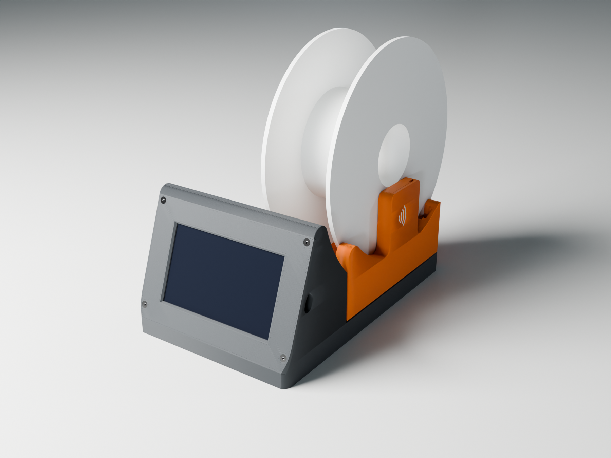

It's an original design, built from scratch. The layout follows the idea of
SpoolmanScale: a screen in front, a cradle on a load cell, and a fin with the reader.
Nothing of SpoolmanScale's enclosure is used; that enclosure is a MakerWorld Exclusive
under its own license. The rollers follow the idea of Bambu Lab's
[spool roller](https://us.store.bambulab.com/products/filament-spool-roller): two
rollers on bearings.

The wiki has the build guide, with the parts to buy:
[openams.si-forge.com/en/openams-ui/spool-station](https://openams.si-forge.com/en/openams-ui/spool-station).

## Ready-made files

`out/` holds every display on both sides, with the screen leaning back 20 degrees and a
platform for each reader:

| Display | Right of the AMS | Left of the AMS | Base |
|---|---|---|---|
| 5" ES3C50P | `out/es3c50p/right/` | `out/es3c50p/left/` | 156 x 254 mm (right), 156 x 241 mm (left) |
| 4.3" ES3C43P | `out/es3c43p/right/` | `out/es3c43p/left/` | 148 x 247 mm (right), 148 x 239 mm (left) |
| 4" E32R40T | `out/e32r40t/right/` | `out/e32r40t/left/` | 130 x 224 mm |

For another tilt, or one reader only, make your own (next).

| 5" ES3C50P | 4.3" ES3C43P | 4" E32R40T |
|---|---|---|
|  | 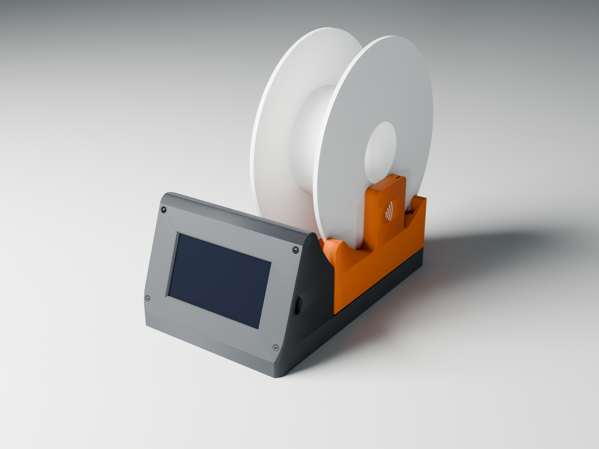 | 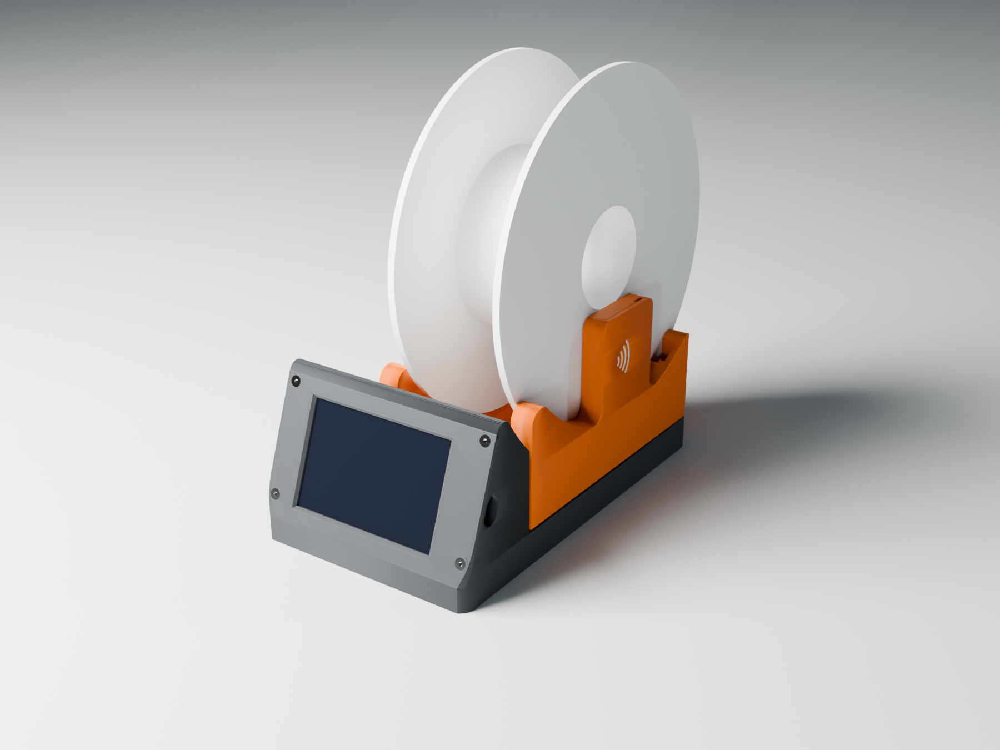 |

## Make your own: the menu

`make.py` asks what to build, the way `make menuconfig` does for the display firmware,
and runs FreeCAD to build it. It needs only FreeCAD; the pictures also need Blender,
and the print check PrusaSlicer, which the pictures use too when it's there.

1. **Install FreeCAD** 0.21 or newer from [freecad.org](https://www.freecad.org/downloads.php),
   and **Python 3** if you don't have it (Windows: FreeCAD's own `python.exe`, in its
   `bin` folder, runs `make.py` too). For pictures, **Blender 4** from
   [blender.org](https://www.blender.org/download/); for the print check,
   **PrusaSlicer** 2.6 or newer from [prusa3d.com](https://www.prusa3d.com/page/prusaslicer_424/).
2. **Open the menu**, in this folder:

   ```sh
   python3 make.py menuconfig        # Linux, macOS (or: make menuconfig)
   python make.py menuconfig         # Windows
   ```

   ```
     OpenAMS spool station: what to build
     --------------------------------------------------------------------------
       1  Display board ............................ 5" ES3C50P (ESP32-S3, 800x480, capacitive touch)
       2  Tag reader ............................... PN5180 (every tag type and format)
       3  Side of the AMS .......................... right of the AMS: the reader's fin on the right
       4  Screen tilt (degrees back from vertical) . 20 degrees
       5  Print bed (mm, square) ................... 256
     --------------------------------------------------------------------------
       6  FreeCAD's command line ................... found: /usr/bin/freecadcmd
       7  Blender .................................. found: /usr/bin/blender
       8  PrusaSlicer .............................. found: /usr/bin/prusa-slicer
       ...
     --------------------------------------------------------------------------
     Files go to out/es3c50p/right
      b  build the files         r  render their pictures    a  both
      c  check they print without support (PrusaSlicer)
      s  save and quit           q  quit without saving      ?  help
   ```

   Type a number to change that choice: each one explains itself and lists its options.
3. **Build:** `b`. It takes about 15 seconds and checks every part against what it
   holds before writing it (see [The checks](#the-checks)). The files go to
   `out/<display>/<side>/`, or `out/<display>/<side>-rake<N>/` for a tilt other than 20.
   `a` builds and renders the pictures into that folder's `pictures/`.
4. **Check:** `c` slices every part with PrusaSlicer and reports whether it prints
   without support (see [Printing](#printing)).

The choices are saved in `station.config`. Without the menu, the same runs from the
command line, and a choice given there overrides the saved one for that run:

```sh
python3 make.py                                  # build what the menu says
python3 make.py BOARD=e32r40t SIDE=left RAKE=25  # a 4" station left of the AMS, 25 degrees
python3 make.py all READER=rc522                 # build for the RC522, and render
python3 make.py check                            # do the last build's parts print without support?
python3 make.py every check                      # every display on both sides, built and checked
python3 make.py show                             # the choices, and where the files go
python3 make.py help                             # every target and choice
```

`make` does the same where there is make: `make BOARD=e32r40t SIDE=left`. `make.py`
finds FreeCAD on the PATH and where it installs (Windows, macOS, Flatpak and Snap); a
FreeCAD AppImage works if you give its path (`FREECAD=~/FreeCAD.AppImage`).

### The choices

| Choice | Options | What changes |
|---|---|---|
| `BOARD` | `es3c50p`, `es3c43p`, `e32r40t` | The display. The case's width and the screen pod follow it; the cradle, rollers and fin are the same. |
| `READER` | `pn5180`, `rc522`, `both` | The platform and fin cap are made for that reader (its ledges sit at its own height). `both` makes one of each. |
| `SIDE` | `right`, `left` | Which side of the AMS 2 Pro. The left-hand station is the right-hand one mirrored. |
| `RAKE` | 10 to 40 degrees | How far the screen leans back from vertical. |
| `BED` | in mm | Your printer's bed, square; the base must fit it. |

### How far the screen can lean back

The screen pod, the crown over the screen and the cradle behind it all follow the tilt.
The further back the screen leans, the further back the cradle sits, so the base gets
longer. On a 256 mm bed (Bambu Lab X1, P1, A1):

| Display | Right of the AMS | Left of the AMS |
|---|---|---|
| 5" ES3C50P | 14 to 20 degrees | 10 to 31 degrees |
| 4.3" ES3C43P | 12 to 27 degrees | 10 to 38 degrees |
| 4" E32R40T | 10 to 40 degrees | 10 to 40 degrees |

A 280 mm bed takes the 5" station to 40 degrees on the left of the AMS and to 34 on the
right; beyond 34 the right-hand one needs 320 mm (`BED=320`). It takes the 4.3" station
to 40 on the left and 36 on the right; beyond 36 the right-hand one needs 320 mm too. Where the pod's ceiling is
too low for the board (see [The screen](#the-screen)), the board moves up the face half a
millimetre at a time and the bezel's border grows with it, the same above and below:
the build prints the border it chose. Beyond 40 degrees the board doesn't fit behind the
face, and below 10 (14 for the 5" right-hand station, 12 for the 4.3") the face passes in front of the
cradle's arc; the build says so and stops.

### The pictures and the 3D model

```sh
python3 make.py render        # the last build's pictures, into its pictures/ folder
python3 make.py glb           # spool_station.glb: the station coming apart, for a glTF viewer
```

Both run Blender in the background. `DEVICE` picks the card it renders on (`auto` takes
the first GPU it finds), `SAMPLES` the quality, `SIZE=50` a quicker, smaller set, and
`SHOTS=station,side` only those pictures. The pictures here come from the 5" right-hand
station.

The printed parts in the pictures are drawn as they come off the printer, not as
modelled. Before it renders, `make.py render` runs `toolpaths.py`, which slices each
part with PrusaSlicer, as it lies in its STL (0.2 mm layers, a 0.4 mm nozzle, three
perimeters, 15 % gyroid infill), and turns the G-code back into geometry: every
extrusion a bead of the width and height PrusaSlicer gives it, flat on top and
underneath and round at the sides. It keeps the beads that can be seen: the outer walls,
the top skins, bridges and overhangs, the first layer, and whatever the next layer
doesn't cover. Then it puts each part back where it sits in the station, or where it
floats in the exploded view. In the cut pictures every bead near the cut is kept and cut
off there, so the cut shows the walls and the infill inside. PrusaSlicer's own "Export
toolpaths as OBJ" does much the same, but only from its window. Without PrusaSlicer, or
with `LOOK=smooth`, the parts are drawn as modelled.

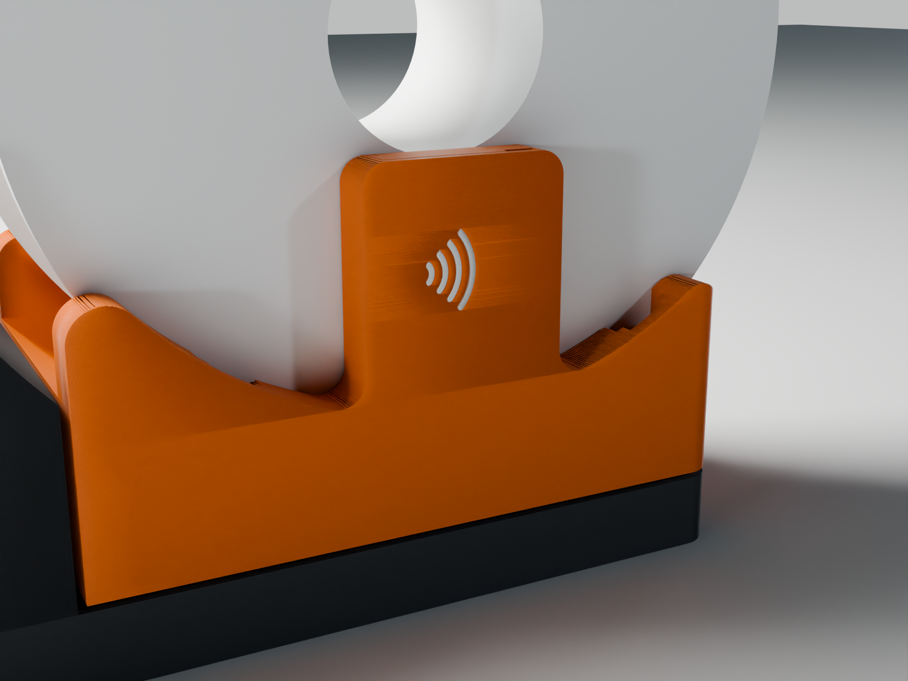

`python3 toolpaths.py out/es3c50p/right` runs it on its own, after a build; the beads go
to `toolpaths/` in each folder of meshes, and `render_blender.py` uses them when they are
there.

### By hand

`make.py` only sets these and runs FreeCAD's command line, so this works too:

```sh
STATION_BOARD=e32r40t STATION_SIDE=left STATION_RAKE=25 \
  freecadcmd -c "exec(open('build_spool_station.py').read())"
blender -b --factory-startup -P render_blender.py -- out/e32r40t/left-rake25/mesh pictures 64
```

`STATION_READER`, `STATION_BED` and `STATION_OUT` are the others. FreeCAD's command line
hides a stop's message; `make.py` shows it.

## Beside the AMS 2 Pro

The base is L-shaped. The screen pod spans the full width, and behind it only the
cradle remains, 98 mm wide. The AMS stands in the notch:

- **Front:** against the pod's back, which is only as deep as the board needs. That puts
  the screen right in front of the AMS's front corner.
- **Side:** against the base beside the cradle.
- **Corner:** the notch's inner corner is rounded round the AMS's corner.

There is 0.8 mm of clearance throughout. The platform's edge sits 2 mm further in than
the base's, so a push from the AMS meets the base, never the scale.


The left-hand station is the right-hand one mirrored, fin on the left:

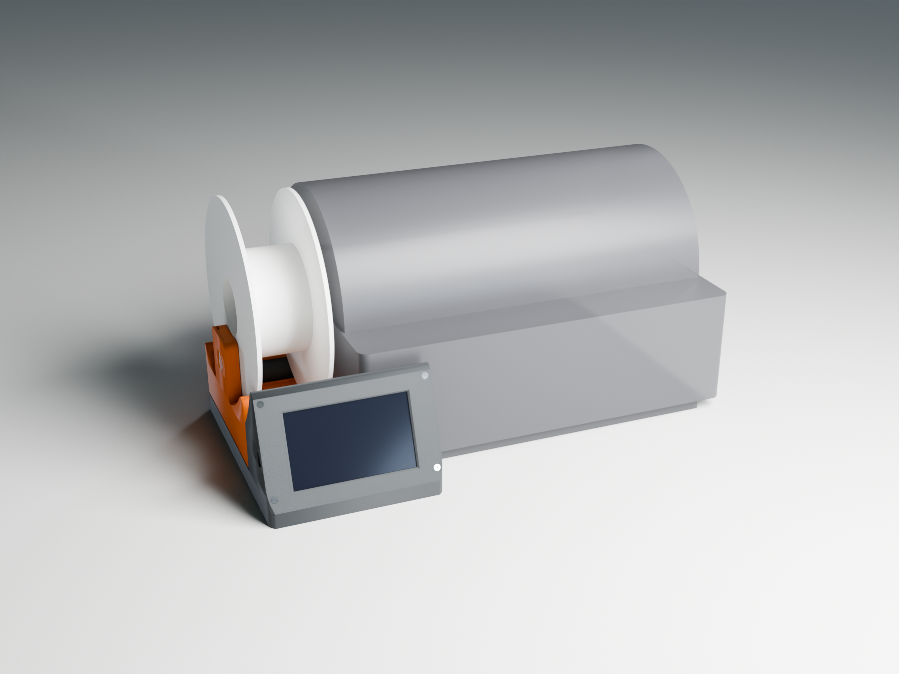

## The screen

The screen leans back 20 degrees from vertical unless you choose otherwise. The bezel's
border is the same above the screen as below it. Above the bezel the base rounds over in
a crown, which runs on into the cradle's arc, so the screen's top follows the arc with no
step.

Inside, the pod's ceiling is one 45-degree plane, rising toward the front to the bezel's
top end, which is cut in the same plane. The base prints it from the back forward, so
no edge of it starts in the air, and the lip over the screen needs no support. That
ceiling has to clear the board and the parts on its back by 2 mm, and the glass and the
bezel's rim by 0.4 mm. Where it doesn't, the board moves up the face, and both borders
grow with it. That is why the 5" right-hand station's border is wider.

What reaches above the ceiling only in places, the plugs along the board's top edge on
the right-hand stations and the 5" and 4.3" boards' microSD card, gets a pocket of its own in the
crown, 1 mm wider than it, under a 45-degree gable 2.5 mm under the crown's top. Each pocket starts
with a flat 3 mm deep, level with the bezel's top end, which prints as a short bridge
between the pocket's sides. The script picks the smallest crown whose pockets clear their
plugs by 2 mm.

The board can't be mirrored, so the two stations hold it differently. Each way, its
USB-C faces the outer wall, by the fin; on the left-hand station, turn the picture round
with Settings, Display, Rotate 180°.

| Display | Station | Board | Plugs | Border | Crown |
|---|---|---|---|---|---|
| 5" ES3C50P | Right-hand | Rotated 180 degrees from LCDWiki's drawing, as the firmware's `BOARD_ROTATED_180` expects | Top edge, sideways, in pockets in the crown | 20.0 mm | 9.25 mm |
| 5" ES3C50P | Left-hand | The right way up | Bottom edge | 15.3 mm | 6 mm |
| 4.3" ES3C43P | Right-hand | Rotated 180 degrees from LCDWiki's drawing, as the firmware's `BOARD_ROTATED_180` expects | Top edge, sideways, in pockets in the crown; UART0 sideways by the USB-C | 19.9 mm | 10.5 mm |
| 4.3" ES3C43P | Left-hand | The right way up | Bottom edge; UART0 sideways by the USB-C | 20.1 mm | 6 mm |
| 4" E32R40T | Right-hand | USB-C on the right | From behind, along the top edge | 9.7 mm | 6 mm |
| 4" E32R40T | Left-hand | USB-C on the left | From behind, along the bottom edge | 9.7 mm | 6 mm |

The 4.3" board's UART0 connector, which gives the PN5180 its 5 V, is on its USB-C edge,
and its plug goes in sideways toward the outer wall. So that case leaves 12.5 mm beside
the board on each side, not 9.5, and the screw column next to the plug has a notch for
it, its roof rising at 45 degrees so it prints.

The 4" board's panel is as wide as its board, so its bezel is narrower. Its reader's
plugs (SPI, I2C and the IO35 input) go into vertical headers on its back; the pod leaves
10 mm behind each for the plug and its wires' turn.

The bezel's corners follow the base's: rounded, ending in a short 45-degree flat at the
front, so that the bezel's lowest corners don't lean out over the bed when it prints
face down. For the same reason its face's edges are square, and its lower end is square
to the face. Its top end is cut at 45 degrees, in the plane of the pod's ceiling, so the
crown prints over it without support.

Its four countersunk screws sit 5.5 mm in from the sides. The upper two are just under
the bezel's top; the lower two as low as they can be with 1.2 mm of bezel between the
countersink and the rounded corner, so they sit higher the more upright the screen.

## The reader

The fin holds either reader where the spool's tag passes. On a refill the tag sits just
outside the cardboard core, about 52 mm from the spool's axis. The boards were measured
from an overhead photo of both, scaled by the RC522's calipered 59.6 x 38.8 mm:

| Reader | Board | Antenna centre from the header edge | Header |
|---|---|---|---|
| PN5180 | 69.1 x 38.9 mm | 48.3 mm | 13 pins, right-angle |
| RC522 | 59.6 x 38.8 mm | 38.5 mm | 8 pins, right-angle |

The board stands in a slot in the fin, header down and its back toward the spool, so its
wires go straight down into the base:

- **Back:** it rests on a rib at each end, 2.2 mm off the fin's inner wall. That clears
  the header's solder joints, so trim them to 2 mm.
- **Antenna:** its centre is right under the spool's axis, 52 mm below it, where the tag
  passes as the spool turns. The copper is 5 mm behind the fin's face.
- **Bottom:** the board's lower corners rest on ledges, at the height that puts its
  antenna there: the PN5180's are 10 mm lower than the RC522's, which is why each reader
  has its own platform. Between the ledges, a pocket open at the bottom takes the Dupont
  plugs, and the wires go straight on down.
- **Top:** the reader's fin cap closes the slot and holds the board down.

The fin stands in the outer rail, under the spool's axis, with a 6 mm fillet where it
rises from the rail at each end. It is 112 mm tall.

| PN5180 | RC522 |
|---|---|
| 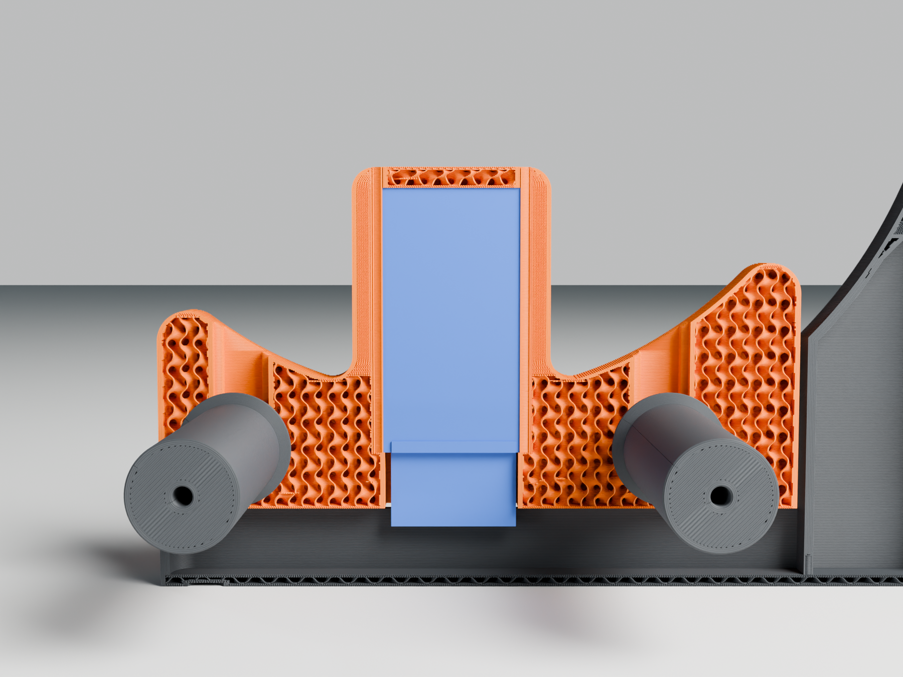 | 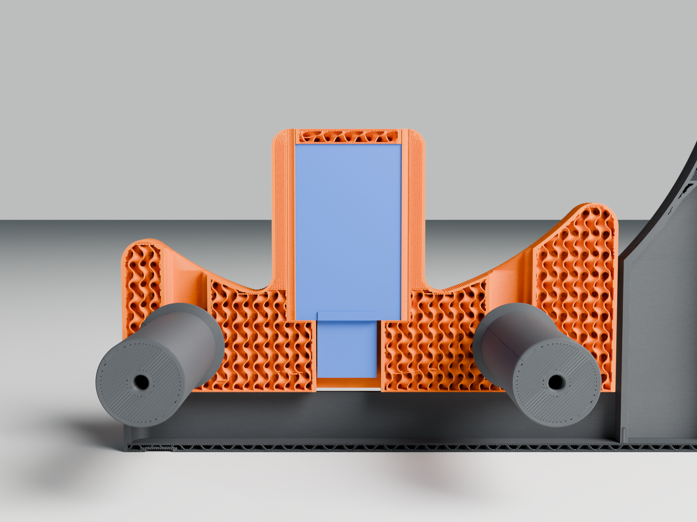 |

## The rollers and catches

The spool sits on two rollers, 55 mm in front of and behind its axis. Each roller is one
printed piece, 24 mm across with flat ends, with an M5 pilot hole in each end. At each end
an M5 x 20 button head screw passes through a 605 bearing and an M5 washer into the
roller: the screw's head, outside the bearing, holds the bearing's inner ring, and the
washer keeps the outer ring off the roller's end. The bearings' outer rings drop into
seats in the side rails, with a shallow slot behind each for the screw's low head, so
most of the rail stays. The rollers stand in troughs in the cradle and lift the spool
9 mm off it. They sit as low as the load cell under the platform allows.

Near the fin, each roller has a collar with 45-degree sides, 2.5 mm high. The spool's
flange on the reader's side runs between the collars and the fin, 1.5 mm clear of the
collars, so that flange stays at the reader. The other flange rides on the plain tube,
wherever the spool's width puts it.

The catches keep the spool from rolling off:

- **Sides:** a rail along each side, 14 mm above the spool's lowest point. The fin
  stands in the outer rail.
- **Back:** behind the rear roller, a lip whose inside hugs the spool 3 mm off it, up to
  45 degrees.

All of it is part of the platform, so a spool leaning on any of it is still weighed. The
rollers carry spools up to 68 mm wide, which covers what the AMS 2 Pro takes.

The load cell's free end, the one bolted to the platform, has its two holes centred
under the spool's axis. The pocket over the cell leaves 2 mm round the potting on its
gauges.

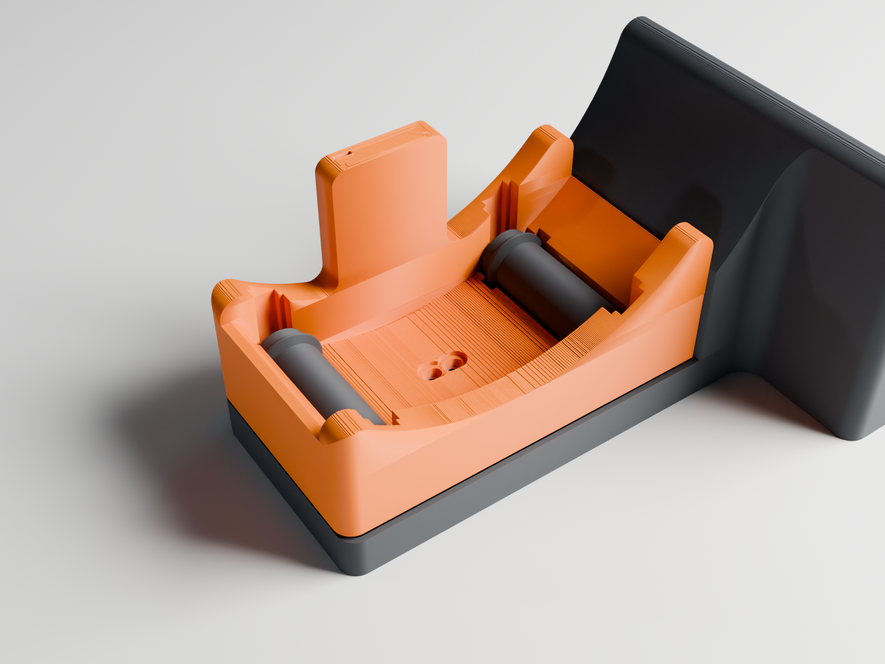

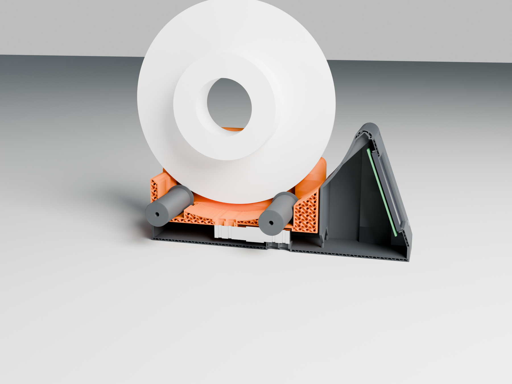

## Files

Each build's folder holds:

| File | What it is |
|---|---|
| `spool_station_base.stl` | Base with the screen pod. Prints as oriented, no supports. |
| `spool_station_bezel.stl` | Screen bezel. Prints face down, no supports. |
| `spool_station_platform_pn5180.stl`, `_rc522.stl` | The cradle, rails and fin for that reader, in one piece, single colour: the RF mark on the fin stays engraved. Prints as oriented, no supports. |
| `spool_station_platform_pn5180_2colour.3mf`, `_rc522_2colour.3mf` | The same platform with the RF mark as a second body, flush in the fin. Give the "RF mark" part a contrasting filament. Use instead of the single-colour platform. |
| `spool_station_platform_mark.stl` | The RF mark alone, for slicers that want the two parts as separate STLs. It fits either platform. |
| `spool_station_fin_cap_pn5180.stl`, `_rc522.stl` | The reader's cap. Prints as it stands. |
| `spool_station_roller.stl` | A roller, standing on its end, collar up. Print two. |
| `*.step` | The same parts for CAD. `spool_station_assembly.step` has the board, load cell, reader, rollers with their bearings, every screw, and a spool; `spool_station_exploded.step` is the same taken apart (see [Putting it together](#putting-it-together)). |
| `build.json` | What the folder was built for: display, side, tilt, readers, and whether the checks passed. |

The scripts: `make.py` is the menu, `build_spool_station.py` the FreeCAD script that
makes the parts, `render_blender.py` the pictures, `toolpaths.py` the printed parts in
them, `make_glb.py` the 3D model and `print_check.py` the print check.

## Printing

PETG or ASA, 0.2 mm layers, 3 walls, 15 % infill, no supports. The platform is solid in
the model, so the slicer's infill carries the cradle's skin.

- **No supports:** nothing leans out more than 45 degrees. The holes that run nearly
  level (the bezel's screw pilots, the room round the board's bosses, the USB-C
  opening) come to a 45-degree point at the top.
- **Bridges:** over the foot recesses (10 mm), the pocket over the load cell (18 mm),
  and the front of each plug pocket in the crown (14 mm at most). The load cell's
  counterbores, under the base, are bridged in two 0.2 mm steps: the first layer
  spans them across and leaves a channel at each screw, the next spans the channels.
  At another layer height it still prints, just less neatly.
- **Rollers:** print them standing, collar end up, on the flat end, about 400 mm2 on the
  bed. Both edges of each end have a 0.4 mm chamfer, against elephant's foot and as a
  lead-in for the screw. The collars have 45-degree sides, so nothing needs support. The
  M5 screws thread themselves into the 4.2 mm pilot holes.
- **RF mark:** it's 1.2 mm deep, because it sits on a vertical face. The colour change
  happens within each layer, so the mark is three 0.4 mm lines thick rather than a few
  layers. The arcs' upper ends come to a point, so the engraving's top needs no support.

### The print check

`python3 make.py check` slices each part of the last build with PrusaSlicer, as it lies
in its STL, at 0.2 mm layers, twice:

- **Supports off:** what it prints over air. Bridges are fine up to 30 mm: the check
  measures each bridge line's longest stretch with nothing under it. An overhanging
  outline that isn't part of a bridge fails.
- **Automatic supports on**, for faces under 35 degrees (the parts' faces are 45 degrees
  or steeper): where PrusaSlicer would put support. Support right under one of the
  bridges is fine; anywhere else, something starts in the air, an edge the first pass
  prints as a plain outline and doesn't flag.

```
  spool_station_base.stl ..................... no support needed
      19 bridges, the longest 14 mm over air
  spool_station_bezel.stl .................... no support needed
  ...
print check: PASS, every part prints without support
```

`VERBOSE=1` lists every bridge. On a fail it says where (x, y and z in the STL), so the
part can be fixed in `build_spool_station.py`. The script is `print_check.py`; it runs
on its own too: `python3 print_check.py out/es3c50p/right`.

## Parts

The wiki's guide links where to buy each.

| Part | Qty | Where |
|---|---|---|
| Display: ES3C50P 5" or ES3C43P 4.3" (capacitive), or E32R40T 4" (resistive) | 1 | Behind the bezel. The 5" board needs R16 removed and R12 bridged, the 4.3" board R21 removed and R20 bridged, as in [the tag writer guide](../../docs/guide/tag-writer.md); the 4" one needs no rework. |
| PN5180 or RC522 module, right-angle header | 1 | In the fin |
| Load cell, 5 kg bar, 75 x 12.7 x 12.7 mm | 1 | Under the cradle |
| NAU7802 breakout | 1 | On the pad in the pod, with foam tape |
| 605ZZ bearing (5 x 14 x 5 mm) | 4 | One on each end of each roller |
| M5 x 20 button head (ISO 7380) | 4 | Through each bearing into the roller's end |
| M5 washer, ISO 7092 (DIN 433), 9 mm across | 4 | Between each bearing and the roller's end |
| M3 x 10 countersunk (ISO 10642) | 4 | Bezel to base, thread-forming into the columns |
| M3 x 6 pan or socket head | 4 | Board to the bezel's bosses, from behind |
| M4 x 12 socket head | 2 | Load cell's fixed end, from below the base |
| M4 x 10 socket head, with washers | 2 | Load cell's free end, from the cradle; M5 if that end's holes are M5 |
| 1.25 mm 4-pin (MX1.25) to Dupont cables | 3 | Board to reader and NAU7802 |
| Rubber feet, 10 mm | 5 | Recesses under the base (optional) |
| Double-sided foam tape | | Reader's back to its ribs; NAU7802 on its pad |

## Assembly

1. **Display.** Lay the board's glass into the bezel's rim, its USB-C toward the fin's
   side: on the right when the bezel faces you on a right-hand station, on the left on a
   left-hand one. Screw it down with the four M3 x 6. On the 4" board, plug the reader's
   cables into its back now (SPI, I2C and the IO35 input; leave the microSD slot empty).
   On the 4.3" board, plug in the UART0 cable for the PN5180's 5 V now too, by the USB-C:
   its plug sits in the notch in the column when the bezel goes on.
2. **Load cell.** Its fixed end is the one the cable leaves, with its holes closer to
   the potting. Bolt it to the block on the base floor, with the M4 screws up through the
   counterbores underneath. The free end, with its holes farther from the potting, is the
   one marked with the 5 kg direction: that mark points down. The slots allow ±1.5 mm,
   for other hole pitches.
3. **Reader.** Plug its wires onto the header and feed them down the fin's slot, out of
   the pocket at the bottom. Slide the board in after them, header down and its back
   toward the spool, until it sits on the ledges. A strip of foam tape on its back holds
   it to the ribs. Press the reader's cap in on top.
4. **Platform.** Set the platform on the cell's free end and screw it on from the
   cradle. It must float: there is 1.5 mm of air above the base walls all round, and
   2 mm at the pod's back wall. Those gaps are also the overload stop.
5. **Rollers.** At each end of a roller, put an M5 x 20 through a 605 and then a washer,
   and screw it into the roller's pilot hole until the head holds the bearing's inner
   ring. Then lower the roller, collar end by the fin, so that the bearings drop into
   their seats in the rails and the screw heads into the slots behind them. The washers
   keep the bearings' outer rings off the roller, so it turns freely.
6. **Wiring.** The reader's wires, and the cell's cable through the NAU7802, run along
   the floor and through the openings in the pod's back wall to the board's connectors.
   [The tag writer guide](../../docs/guide/tag-writer.md) has the reader's pins for each
   board. Leave the reader's wires slack under the platform: a taut wire takes weight
   off the scale.
7. **Close.** Put the bezel on the pod and drive the four countersunk screws. The USB-C
   cable plugs in through the opening in the outer wall. Plugs up to 12.4 x 6.4 mm fit.

## Putting it together

The station taken apart the way it goes together. The dashed blue lines show each part's way in:
the board onto the bezel, the bezel onto the pod's screw columns, the platform down onto
the load cell's free end, the reader and its cap down into the fin, and each roller down
into its seats.

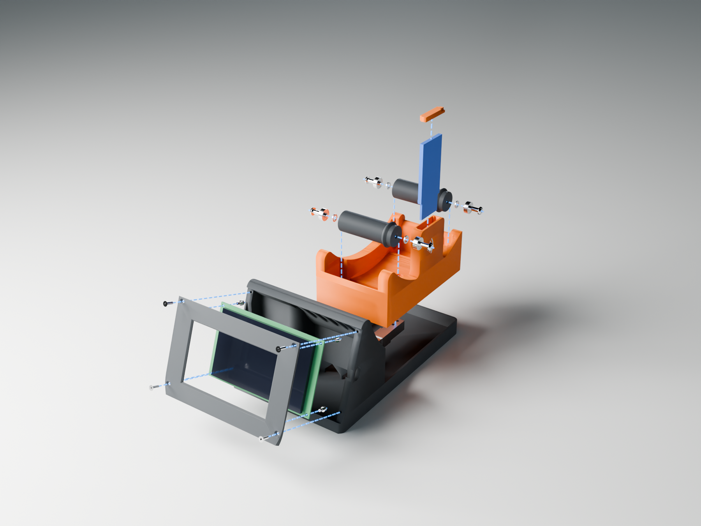

The board goes onto the bezel's four bosses with M3 x 6 socket heads from behind, through
its corner holes. The bezel then goes onto the pod with four M3 x 10 countersunk screws,
into the columns inside the side walls; their heads sit flush in the bezel's face:

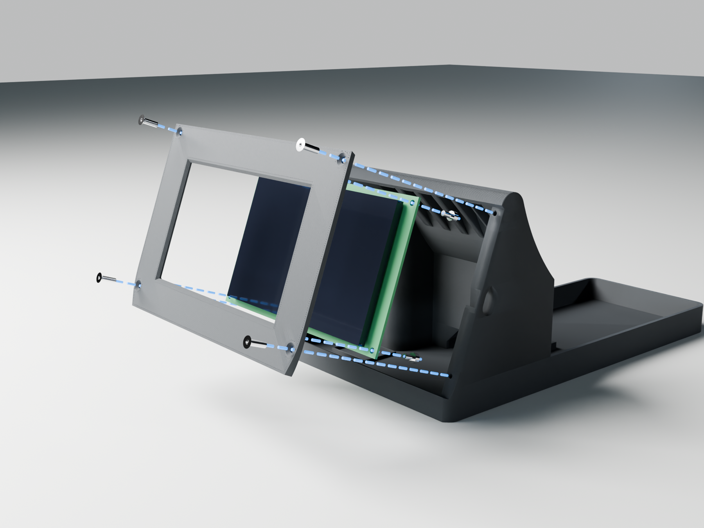

Each roller is one printed piece, two 605 bearings, two M5 washers and two M5 x 20
screws. At each end the screw goes through the bearing and the washer into the roller, and
the set drops into the rails' seats, collar end by the fin:

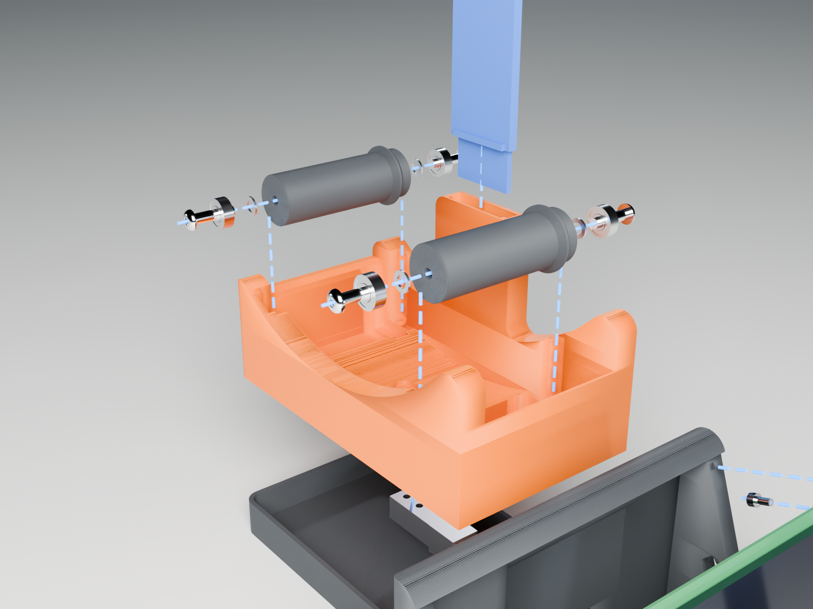

The screw and washer in the model are downloaded models of the real parts, and the 605
is built from its standard dimensions (see [`parts/`](parts/README.md)).

## Before you print: measured or assumed

These sizes are set at the top of `build_spool_station.py`. Check them against your
parts, then build again.

| Parameter | Now | What it sets |
|---|---|---|
| `BOARDS` | The three displays | Each display's board, glass, visible area, holes, USB-C and plugs. The 5" board's are from LCDWiki's drawing (`5inch_ESP32S3_Size.pdf`, V1.0, ±0.2 mm); the 4.3" board's from its drawing (`4.3inch_ESP32S3_IPS-模型.pdf`, V1.0), which a board matched where it was measured (the glass's place on the PCB, the active area's in the glass, and 7.9 mm from the glass's front to the PCB's back); the 4" board's from its drawing (`E32R40T_Size.pdf`, V1.0) and LCDWiki's STEP model of it. |
| `TAG_R` | 52 mm | Distance from the spool's axis to its tag's centre: just outside a refill's cardboard core, measured from a photo with the filament's strands as the scale. It sets the reader's height. |
| `READERS` | See [The reader](#the-reader) | The boards: measured from a photo, scaled by the RC522's calipered size, so about ±0.5 mm. `front` is the tallest part on the component side: the RC522's crystal is taken as 4.6 mm. |
| `STANDOFF` | 2.2 mm | The board's back off the fin's wall: the header's solder joints. |
| `CELL_L`, `CELL_HOLES` | 75.05 mm; 5.6 and 15.6 mm from each end | The bar's length, calipered, and where its screws go, measured from a photo: 5.5 and 15.1 mm at the cable end, 5.8 and 16.0 at the other. The ±1.5 mm slots take the difference. |
| `POTTING` | 15 mm across, 25.3 to 42.9 mm from the cable end | The potting over the cell's gauges. The pads at the cell's ends stop short of it, and the platform clears it. |
| `SPOOL_R`, `SPOOL_W` | 100, 67 mm | A Bambu Lab 1 kg spool. |
| `ROLLER_Y`, `ROLLER_D` | 55 mm, 24 mm | The rollers' place from the spool's axis, and their size. |
| `CRADLE_W` | 85 mm | Cradle width from the fin: the rollers carry spools up to 68 mm wide. |
| `AMS_GAP` | 0.8 mm | Clearance to the AMS's front, side and corner. |
| `AMS` | 372 x 280 x 226 mm | The AMS 2 Pro, for the fit check. The overall size is Bambu Lab's. The rest is measured from their product photos, not from a unit: the 11.7 mm base under the shell, set in 7 mm at the front and 22 mm at the sides, and the lid's dome. The vertical corner radius, 10 mm, is a guess; the notch's corner is rounded to it. |

## The checks

Every build tests the parts before it writes them:

- **Held parts and plugs:** each is tested against the printed parts: the board, the
  glass, the space behind the board, the header plugs, the microSD card, the USB-C plug,
  the load cell, both readers with their plugs, the rollers, a spool and the AMS 2 Pro.
- **Scale:** the platform floats, the load cell touches the platform only at its free
  end, the spool rests on the rollers alone, and the AMS stays clear of the platform.
- **Fit:** the base fits the bed.

The last line is `checks: PASS` or `FAIL`; `make.py` stops with a message on a fail, and
the files it wrote are left to look at. If the board can't fit behind the face, the
build stops and says so. Whether the parts print without support is a separate check
that slices them: [The print check](#the-print-check).
